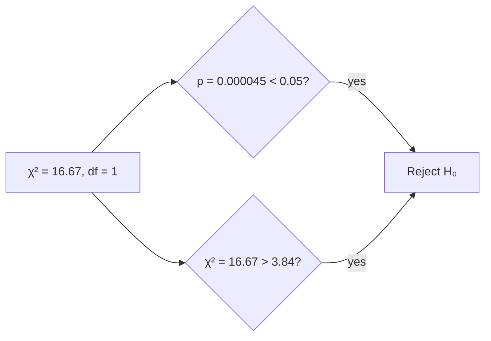

# p-Value in Simple Terms

The p-value answers:

> **"If there were actually no real effect, how likely is it that I'd see data this extreme (or more extreme) just by random chance?"**

It's a probability, so it ranges from 0 to 1.

## The coin-flip intuition 🪙

A friend claims his coin is fair. He flips it 10 times and gets 9 heads. You're suspicious.

- **Null hypothesis (H₀):** the coin is fair
- **p-value:** *if the coin were truly fair*, how often would 9+ heads out of 10 happen by luck alone?

That probability is about **0.011** (1.1%). Pretty unlikely under a fair coin — so you doubt H₀. The coin is probably biased.

Key mental model: the p-value **assumes H₀ is true and asks how surprising your data is**. It is *not* the probability that H₀ is true.

## Back to our chi-square example

- χ² = 16.67, df = 1 → **p = 0.000045**
- Meaning: *if gender and drink choice were truly unrelated*, the chance of seeing a table this lopsided is about **1 in 22,000**
- That's so unlikely that we reject H₀ and conclude the variables are related

## How to read a p-value

| p-value | Interpretation |
|---|---|
| > 0.05 | Data is compatible with chance — no significant evidence against H₀ |
| 0.01 – 0.05 | Moderate evidence against H₀ |
| < 0.01 | Strong evidence against H₀ |

## Three classic misconceptions ⚠️

1. **p = 0.03 does NOT mean "3% chance the null is true."** It's the reverse: *given* H₀ is true, there's a 3% chance of data this extreme.
2. **p > 0.05 does NOT prove H₀ true.** It only means you lack evidence against it — absence of evidence ≠ evidence of absence.
3. **Significance ≠ importance.** With huge datasets, trivial effects get tiny p-values. Effect size matters too.

## Connection to the critical value

The p-value and critical value are two routes to the same decision:

The p-value is more informative, because it tells you *how strong* the evidence is — not just which side of the threshold you're on.
